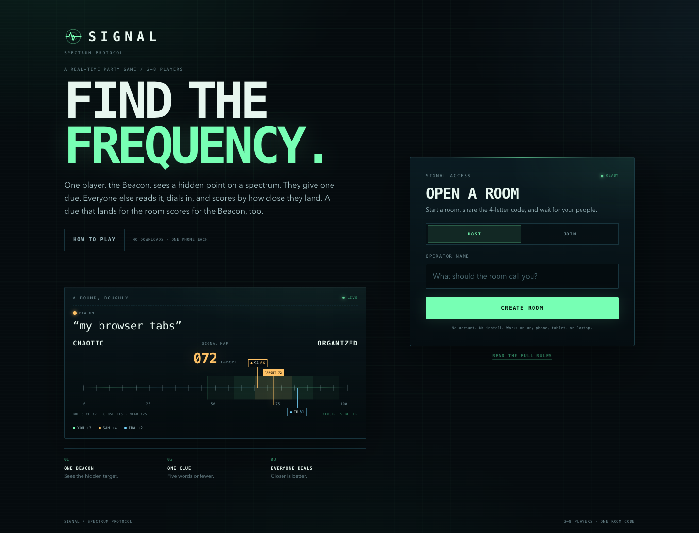
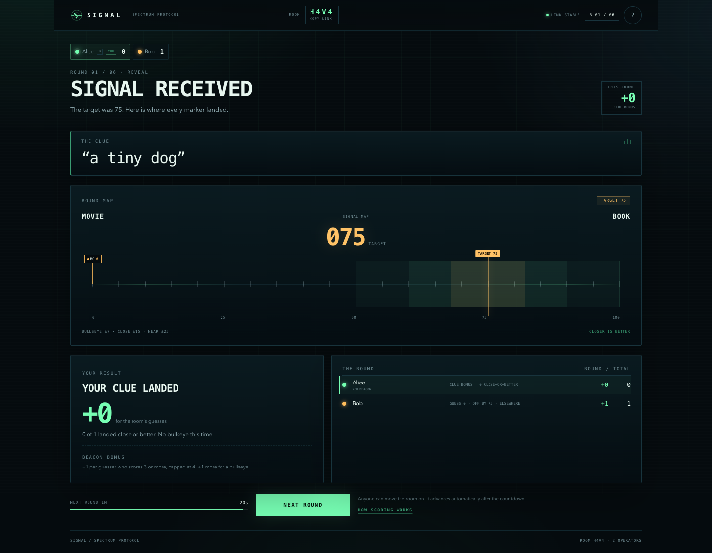
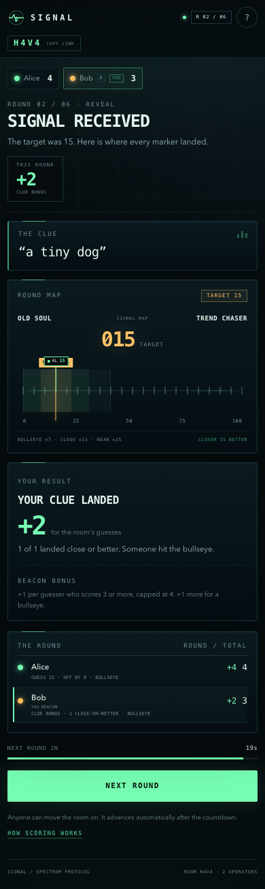

# SIGNAL

A live spectrum party game for 2–8 players. One player, the Beacon, sees a hidden point on a spectrum and gives a single clue. Everyone else reads it, dials in, and scores by how close they land. A clue that lands for the room scores for the Beacon, too.

**Play it live: https://signal-spectrum-khsmca9k4iv.qoder.website**



## How to play

1. **One Beacon.** The app names one player. Only their screen shows the hidden point on the round's spectrum.
2. **One clue.** The Beacon sends one clue of up to five words. No numbers, no words from the spectrum, no obvious synonyms.
3. **Everyone dials.** Everyone else places a marker on the dial and locks in. Thirty seconds, no talking before the lock.
4. **Reveal.** The target appears, every marker is shown, and points land. The next player takes over as Beacon.

Everyone gets a turn as Beacon. In a 2 or 3 player game, everyone gets two turns. The match ends after the last scheduled round; a tie for first goes to one sudden-death round.

### Scoring

| Band | Distance from the target | Points |
| --- | --- | --- |
| Bullseye | within 7 | 4 |
| Close | within 15 | 3 |
| Near | within 25 | 2 |
| Elsewhere | anywhere else | 1 |

The Beacon earns **+1 for every guesser who scores 3 or more** (capped at 4), plus **+1 if anyone hits the bullseye**. A good clue pays.

The rules also live inside the game: the How to Play card opens automatically on the first visit and remains available from the header. No one needs a rules explanation from the host.

## What is in the box

- Room codes for 2–8 players, with no accounts or installs.
- Server-authoritative rounds, timers, scoring, sudden-death tiebreaks, and a final standings screen.
- Player-specific API views: a Beacon's target is never sent to another player before the reveal.
- Versioned room rows and conditional writes, so two people locking in at once cannot overwrite each other.
- Reconnect support via a player token in local storage; refreshing keeps your seat.
- A responsive mission-control interface built for one phone per player.
- No WebSocket server. Turn-based state is polled once a second; the free hosting tier is plenty.

## Stack

- React 19, TypeScript and Vite for the client.
- A Qoder Sites Edge Function for the game API at `/functions/v1/app`.
- Postgres with one `app.rooms` row per room. The room state lives in JSONB; a `version` column provides compare-and-set updates.
- Local development uses an in-memory repository with the same interface as the deployed database adapter.
- All styling is handwritten CSS. No external fonts, images, or UI kits are required.

## Run locally

```bash
npm ci

# terminal 1: the local game function on port 8000
node dev/server.mjs

# terminal 2: the Vite client, proxying /functions/v1/app to port 8000
npm run dev
```

Open the Vite URL (usually http://127.0.0.1:5173). Open a second browser window or a private window, join the room code, and play. The local server keeps state in memory, so a restart clears rooms.

Build the deployable client with `npm run build`. The output is `dist/`; the function source is in `functions/`.

## Tests

- `node dev/simulate.mjs` exercises the full game logic without a browser: six rounds, scoring, target privacy, clue validation, timeout resolution, auto-advance, rematch, host transfer, and lobby leave. It prints a check for each stage.
- `node dev/live-api-test.mjs` runs a complete six-round match against the deployed site and verifies the final 12–9 result and privacy rules. It creates a test room and deletes it when finished.
- With both local servers running and Playwright installed (`npm i --no-save playwright`), `node dev/ui-game.mjs` drives two Chrome windows through a full six-round game and checks the final standings. It uses the locally installed Google Chrome channel.

## Screenshots





## Design notes

The server owns the entire game. Every response is built for the player who requested it: the target goes only to the current Beacon (or to everyone after the reveal), other players' guesses are hidden until the reveal, and the raw room row is never returned. Conditional writes use the room code plus the current row version; a stale write is retried by re-reading the room instead of clobbering it.

The guessing timer is 30 seconds, the reveal auto-advances after 20 seconds, and the client submits a late marker automatically. A 30-second timeout resolves an unlocked marker at the center server-side as well, so an offline player cannot stall the room.

Rooms are intentionally lightweight and are not automatically expired. This is a party game, not an account system.

The base project is the Qoder Sites React starter. Third-party stylesheet attribution is preserved in `PROVENANCE.md` and `vendor/`.
